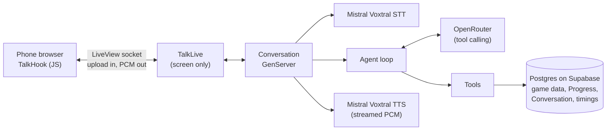
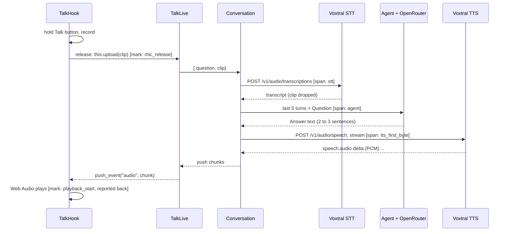
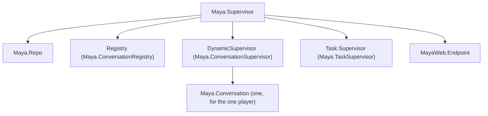

# ARCHITECTURE.md: Maya

Last updated: 14 Nov 2026. Designed with Abhishek in a grilling session (F3). Terms in **bold** are defined in `GLOSSARY.md`. The product is in `PRODUCT.md`; the frozen stack is in `CLAUDE.md`.

## Shape in one picture

One Phoenix app on Render (Frankfurt), one Postgres on Supabase (Ireland, ADR-002). No other services.

## Why Elixir and Phoenix

Voice is the experience (CLAUDE.md product principle), so the stack is chosen for the push-to-talk loop, not for AI libraries.

- **One process per Conversation.** A turn is a small concurrent workflow: upload, STT, agent rounds, a TTS stream, and a barge-in that can arrive at any moment. A GenServer with monitored Tasks models that directly; cancelling a turn is killing its Tasks ([GenServer](https://hexdocs.pm/elixir/GenServer.html), [Task.Supervisor](https://hexdocs.pm/elixir/Task.Supervisor.html)).
- **Crash recovery without dropping the player.** A failed STT or agent call crashes one Task, not the screen. Supervisors restart the Conversation, which reloads its turns from Postgres (ADR-006), while the LiveView stays connected ([Supervisor](https://hexdocs.pm/elixir/Supervisor.html)).
- **One socket for everything.** LiveView already holds a WebSocket to the phone. Audio goes in as a LiveView upload and PCM comes back as pushed events on the same connection (ADR-005): no separate API server, no SPA, no CSP changes, and keys never reach the browser ([Phoenix.LiveView](https://hexdocs.pm/phoenix_live_view/Phoenix.LiveView.html)).
- **Streaming is cheap.** Relaying `speech.audio.delta` chunks as they arrive is a receive loop in the Conversation process; the BEAM scheduler keeps many such loops responsive on a 0.5 CPU, 512 MB Render instance.
- **Timing is built in.** `:telemetry.span` gives per-stage latency for the five voice stages with no extra service ([telemetry](https://hexdocs.pm/telemetry/telemetry.html)).
- **Small surface.** One deployable (a release in one Docker image), one language for server and screen logic, and the JavaScript limited to one hook for the mic and Web Audio.

### Functional programming

Elixir is functional: data is immutable and code is mostly pure functions over it. Maya leans on that to keep its one promise (zero Spoilers, correct Facts) testable.

- **A pure core, a thin shell.** The rules live in pure functions with no IO: `Horizon.allowed?(location, progress)`, `Horizon.next_gym(progress)`, the matchup math in `gym_counter`, and turning tool results into the messages sent to the model. Processes, HTTP and Postgres sit around that core. The spoiler probe set and the Roxanne and Ralts checks then run as plain unit tests on data, with no mocks and no network.
- **Immutable state, changed in one place.** A Conversation's state (turns, the turn in flight, playback status) is a value the GenServer replaces on each message. Nothing else can change it behind its back, so a barge-in racing a TTS chunk resolves in the order the messages arrive.
- **Pattern matching on untrusted shapes.** Model replies and tool calls are matched by shape (`%{"tool_calls" => calls}` versus a text answer, `{:ok, _}` versus `{:error, _}` per call), so a malformed `arguments` string becomes an explicit branch, not a crash deep in the loop ([pattern matching](https://hexdocs.pm/elixir/pattern-matching.html)).
- **Pipelines for data.** The import is a chain of small transformations (`File.read!/1 |> Jason.decode!() |> to_rows() |> Repo.insert_all/2`), each testable on its own with a fixture from `priv/data/`.
- **Tagged results, not exceptions.** Tools return `{:ok, fact}`, `{:error, :not_found}` or `{:error, :past_horizon}`. The agent turns each into the right spoken line ("Not sure", "Further ahead"), so every failure in the PRODUCT.md table is a value we can assert on.

What it costs:
- **No official AI SDKs.** OpenRouter and Mistral are called with Req, and the agent loop is hand-written (CLAUDE.md). That is a few hundred lines we own and test, which also keeps ADR-004's rules visible in our code rather than inside a framework.
- **No local ML.** Bumblebee models do not fit in 512 MB, so embeddings use the Mistral API.
- **Browser audio is still JavaScript.** Recording and Web Audio playback live in the hook, so its state machine needs the same care as the server side.

## 1. The voice loop

- **Talk button:** a JS hook built as an explicit state machine (`idle, recording, uploading, waiting, speaking`), per the voice lessons in `docs/factory-learnings.md`. One hold makes exactly one **Question**.
- **Upload:** `allow_upload(:question, auto_upload: true, chunk_size: 256_000, max_file_size: 1_000_000, max_entries: 1)`; the hook calls `this.upload`. One chunk for a normal Question. [LiveView uploads](https://hexdocs.pm/phoenix_live_view/uploads.html), [JS interop](https://hexdocs.pm/phoenix_live_view/js-interop.html).
- **Recording format:** MediaRecorder gives MP4/AAC on iOS and WebM/Opus on Chrome; Mistral does not document which containers transcription accepts ([audio formats](https://docs.mistral.ai/studio/audio/specs-and-limits/audio-formats)). Block 2 starts with a curl spike on one real clip of each. If either fails, the hook records 16 kHz mono WAV with Web Audio instead. No server transcoding.
- **STT:** `voxtral-mini-transcribe-3`, multipart `file` ([transcribe files](https://docs.mistral.ai/studio/audio/speech-to-text/transcribe-files)). The clip is dropped after the call; only the transcript is kept.
- **TTS:** Voxtral TTS 3 with `stream: true`, `response_format: pcm`; server-sent events `speech.audio.delta` then `speech.audio.done` ([stream speech](https://docs.mistral.ai/studio/audio/text-to-speech/stream-speech)). The server relays chunks over the socket (STT and TTS are always proxied, never called from the browser). The hook plays them with Web Audio as they arrive. The PCM sample rate is checked in the Block 2 spike before playback code is written.
- **Barge-in:** a hold while Maya speaks stops the audio graph at once, the hook sends `barge_in`, and the Conversation cancels the TTS stream. The cut **Answer** stays as text.
- **Answer time:** p50 at most 5 s, p95 at most 8 s, from mic release to playback start.

### Failures

| What fails | What the player sees |
|---|---|
| STT or TTS errors or times out | The Answer as text with a short "voice is down" note (PRODUCT.md). No Web Speech fallback. |
| Agent or OpenRouter errors | One short spoken line ("Lost my train of thought, ask again?"), never silence. |
| No Fact from any tool | "Not sure" in one line (ADR-004). |
| Question past the **Spoiler horizon** | "Further ahead, no spoilers" plus a hint inside the horizon; no place is named. |
| Conversation process crashes | It restarts and reloads the last turns from Postgres; the screen keeps its history. |

## 2. Processes

- **Conversation:** a GenServer started on demand under the DynamicSupervisor and found through the Registry. It owns the turn in flight: STT, agent and TTS run as supervised Tasks it monitors, so a barge-in or a crash cancels them cleanly.
- **TalkLive** only draws the screen and subscribes to the Conversation. A dropped socket or a phone that sleeps reconnects to the same Conversation; work in flight is not lost.
- There is one **Conversation**, kept forever. Every Question and Answer (text only) is a row in Postgres. The agent gets the last 5 turns; the screen shows recent turns.

## 3. Agent

A hand-written loop inside the Conversation's Task: call OpenRouter with the messages and `tools`, run each `tool_calls` entry, append one `role: "tool"` message per call with its `tool_call_id`, repeat until the model answers in text (cap: 4 rounds). `tools` is sent on every request; each `arguments` is a JSON string parsed per call ([OpenRouter tool calling](https://openrouter.ai/docs/guides/features/tool-calling)). Calls go through Req.

- **Model:** a name in config. Block 3 runs the Roxanne Question through 2 or 3 fast models that support tools and keeps the one with the best agent-stage latency that gets the Facts right. The choice and the numbers go in an ADR.
- **System prompt rules:** game Facts only from tool results this turn (ADR-004); never past the Spoiler horizon; 2 to 3 spoken sentences; the **Dials** (humor from Progress settings, honesty 90, sass 40, spoilers 0 locked, Mudkip hype 100); the **Catchphrase** after good news.

| Tool | Arguments | Returns | Spoiler horizon |
|---|---|---|---|
| `gym_counter` | `leader` | The leader's team and levels, the player's **Team** with type matchups, a suggested lead | Only the **Next gym** or earlier gyms; later leaders return `past_horizon` |
| `find_pokemon` | `name` | Types, evolution level, encounter places with rates | Only places inside the horizon; none left returns `past_horizon` |
| `search_guide` | `location` (optional) | **Walkthrough notes** for the named or current location | SQL filter on `badges_required` |
| `log_event` | `kind` (`badge_earned`, `caught`, `evolved`, `moved`, `undo`), `details` | The confirm line | Writes the **Event** and updates **Progress** in one transaction; `undo` reverts the last Event |
| `set_setting` | `name` (`humor` only in the MVP), `value` 0 to 100 | The confirm line | n/a |

## 4. Data

| Table | From | Notes |
|---|---|---|
| `species`, `moves`, `type_matchups` | PokeAPI (Emerald version group) | Types as in Emerald (no Fairy) |
| `encounters` | pokeemerald `src/data/wild_encounters.json` | Land, water and fishing with rates |
| `trainers`, `trainer_pokemon` | pokeemerald `src/data/trainer_parties.h` | Gym leaders tagged with their badge number |
| `locations` | Hand-written | `badges_required` per location, Littleroot to Rustboro for Sunday. A location not in the table counts as past the horizon (fail closed). |
| `walkthrough_notes` | Written by Claude from the game data | Location, `badges_required`, text. SQL search in the MVP; pgvector embeddings later, first in the cut order. |
| `progress`, `events` | Seed `priv/progress.json` once, then `log_event` | Badges, Team, location, Humor dial. Survives deploys (ADR-006). |
| `turns` | The Conversation | Question text, Answer text, cut flag, per-stage milliseconds |

- **Import:** `mix maya.fetch_data` pulls pokeemerald files from a pinned commit and the PokeAPI species Maya needs into `priv/data/`, which is committed. `mix maya.import` loads Postgres only from `priv/data/`, so deploys and tests never hit the network.
- **Spoiler horizon:** the Next gym is the first badge not in Progress. Allowed locations are those whose `badges_required` is at most the badges earned.
- **Latency:** each stage runs in `:telemetry.span([:maya, :voice, stage], ...)`; a handler writes the milliseconds onto the turn row. `mix maya.latency` prints p50 and p95 per stage, the numbers every voice-loop PR shows before and after.

## 5. Config and deploy

- Secrets (names only; values live where FACTORY.md says): `OPENROUTER_API_KEY`, `MISTRAL_API_KEY`, `DATABASE_URL`, `SECRET_KEY_BASE`, `BASIC_AUTH_USERNAME`, `BASIC_AUTH_PASSWORD`. Each new one is added to `render.yaml`, `config/runtime.exs` and `.env.template` in the same PR.
- Config, not secrets: `:agent_model`, `:stt_model`, `:tts_model`, timeouts per stage.
- Deploy: unchanged. Render web service, `checksPass`, pre-deploy migrations; `/health` stays DB-free. `mix maya.import` runs as a one-off after a data change.
- Content-Security-Policy: unchanged. Audio goes over the LiveView socket, so `connect-src 'self'` is enough; the mic needs HTTPS, which Render gives.

## 6. Build order

Each block becomes one OpenSpec change and one GitHub Issue. Blocks 1 to 4 reach the PRODUCT.md "Done when (Sunday)".

| # | Block | Done when | Estimate | Change id |
|---|---|---|---|---|
| 1 | Data and horizon | `mix maya.fetch_data` and `mix maya.import` fill the tables from committed files; Roxanne's team and Ralts' Route 102 rate are queryable; horizon tests pass for 0 and 1 badges | 2h | `game-data-and-horizon` |
| 2 | Voice spine | Format spike recorded; on the phone, a hold is transcribed and spoken back (echo, no agent) with all five stage timings on the turn row; barge-in stops speech; voice outage shows text | 2h | `voice-spine` |
| 3 | Agent | "How do I beat Roxanne?" out loud returns 2 to 3 sentences naming a counter from the Team and Roxanne's ace; model choice ADR with numbers | 2h | `agent-loop` |
| 4 | Sunday proof | Ralts Question in the same Conversation; 20-question spoiler probe set passes; 10 holds in a row make 10 Questions; Answer time under 8 s | 1h | `sunday-proof` |
| 5 | After Sunday | `log_event` with undo, Humor dial by voice, `search_guide` with Walkthrough notes Littleroot to Dewford | 2h | `events-dials-guide` |

Cut order if time runs out: embeddings (already out of the MVP), the Events log beyond Progress (the "journal"), then Dials.

## Decisions

From the F3 session, all Abhishek's answers:

1. Conversation in its own GenServer; the LiveView only draws.
2. Progress in Postgres, seeded once (ADR-006).
3. Voice spine before the full agent.
4. Guide search by location in SQL; no embeddings before Sunday.
5. Agent model chosen by measurement in Block 3.
6. Answers stream as PCM, played with Web Audio (ADR-005).
7. `/` becomes the Talk screen.
8. Horizon map is a hand table that fails closed.
9. Past the horizon: "Further ahead" plus a hint, no place named.
10. The journal is the Events log only.
11. One Conversation forever, text in Postgres (ADR-006).
12. Per-stage timings stored per turn.
13. Questions arrive as a LiveView upload (ADR-005).
14. Format spike first, WAV fallback, no transcoding.
15. Events through one `log_event` tool with undo.
16. Game data fetched once and committed.
