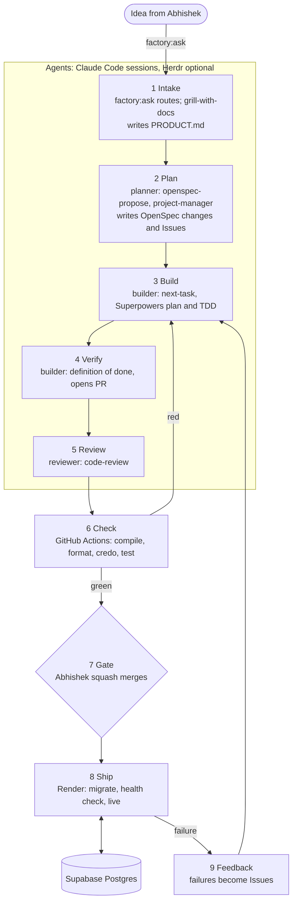
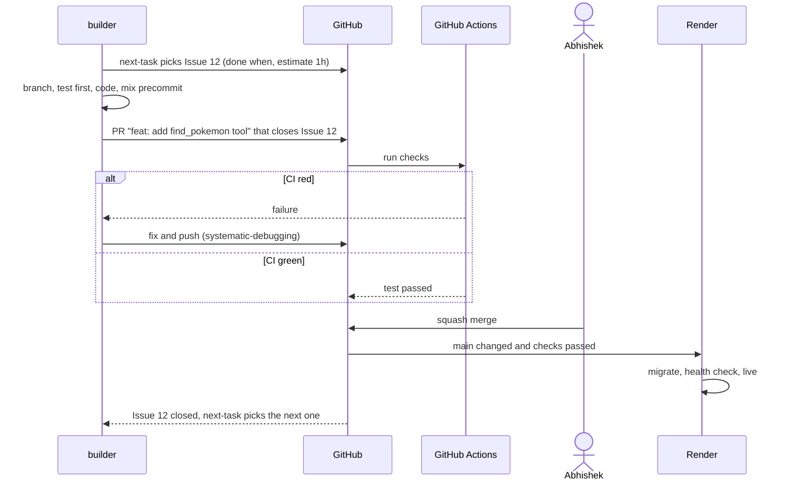

# FACTORY.md: Maya Software Factory
Last updated: 16 Nov 2026

## Purpose
An agent-run pipeline that builds Maya from PRODUCT.md to a live Render deploy.
Human jobs: write PRODUCT.md, answer agents, tap Merge. Everything else is the factory.
Public tour for visitors, with the numbers from `docs/factory/experiments.md`: the `/factory` page on the live app.

## Product principle
Voice is the experience. Any Issue touching the voice loop must include a latency check in its "done when".

## Tools
| Tool | Role |
|---|---|
| Claude Code | The agent in every role, and the default runtime: one session per role, builders in their own git worktree, background sessions, Remote Control for the phone |
| Herdr (optional) | Devex layer on the same sessions: panes with working/blocked/done state in one sidebar, agents prompting each other via socket API |
| Matt Pocock skills | Upstream: grill, PRD, issues, code review |
| Superpowers (obra) | Downstream: plan, TDD, subagent execution, verify, finish branch |
| GitHub | Repo, Issues (work queue), PRs |
| GitHub Actions | CI checks |
| Render | Auto-deploy on merge to main (Frankfurt) |
| GitHub app + Remote Control | Human gate on the phone: merge in the GitHub app, answer blocked sessions via Claude Code Remote Control |

## Lines
| # | Line | Where | Skill / action | Output | Done when |
|---|---|---|---|---|---|
| 1 | Intake | Session `planner` | `factory:ask` routes, Matt `grill-with-docs` interviews | PRODUCT.md, GLOSSARY.md | Committed |
| 2 | Plan | Session `planner` | `openspec-propose`, `project-manager` | ARCHITECTURE.md, `openspec/changes/<id>/`, one GitHub Issue per change | Every Issue links its change and has a "done when" |
| 3 | Build | Session `builder-<issue>` | Superpowers plan, TDD, subagents | Branch with code and tests | Tests pass locally |
| 4 | Verify | Session `builder-<issue>` | Superpowers verify, finish branch | PR | PR opened, linked to Issue |
| 5 | Review | `reviewer` (spawned by builder) | Matt `code-review` | PR review comments | No blocking comments |
| 6 | Check | GitHub Actions | `mix format --check-formatted`, `mix credo`, `mix test` | CI status | Green |
| 7 | Gate | GitHub (web or mobile app) | Squash merge | Merged | You merged |
| 8 | Ship | Render | Auto-deploy from main | Live app | Health check passes |
| 9 | Feedback | Actions / watcher | Failures become Issues | New Issue | Back to line 3 |

## How it works

### The pipeline

### One Issue's life

### Guardrails that agents cannot talk past
| Risk | Stopped by | Where |
|---|---|---|
| Agent merges its own PR | `gh pr merge` denied | `.claude/settings.json` |
| Push to main, force push | Branch protection, admins included | GitHub settings |
| Broken code ships | Required `ci-success` check (format, credo, test with coverage floor, security, docker boot), Render `autoDeployTrigger: checksPass`, scheduled post-deploy smoke check (never blocks a deploy) | GitHub, `render.yaml` |
| Stack drift | `settled-architecture` red flags, ADR for any change | Repo |
| "Works on my machine" | Definition of done with evidence | `CLAUDE.md`, PR template |
| Scope creep | New ideas go to `PHASE_2.md` | Repo |
| Overrun | 2x estimate means a cut, F1 past 3h means build by hand | `project-manager` skill |
| Overlapping skills (Matt `tdd`, `diagnosing-bugs` vs Superpowers) | `Skill(skill:...)` deny rules | `.claude/settings.json` |
| Leaked secrets | `.env` git and Docker ignored and read denied, secrets `sync: false` | Repo, Render |

Critical rules are enforced by machines that ignore prompts (GitHub, the permission deny list, Render). Skills only make the right path the easy one.

## Skill ownership rules
1. One owner per station. Matt owns intake (`grill-with-docs`) and review (`code-review`). OpenSpec owns specs (`openspec-propose`, `openspec-update-change`, `openspec-archive-change`). Superpowers owns build and verify. Denied in `.claude/settings.json`: `openspec-apply-change`, Matt `to-spec`, `to-tickets`, `tdd`, `diagnosing-bugs` (ADR-003).
2. Specs live in `openspec/specs/` and are the source of truth for behaviour. A builder implements an Issue from its change's `tasks.md` and `specs/`, then runs `openspec-archive-change` in the same PR, so specs and code merge together.
3. TDD: Superpowers only. Do not invoke Matt `tdd`.
4. Superpowers auto-triggers via SessionStart hook. Decided 2026-11-14: keep it in every session, `planner` included. At intake, invoke `grill-with-docs` explicitly; it owns the interview, not Superpowers brainstorming.
5. Run `/setup-matt-pocock-skills` once: tracker = GitHub, docs = `docs/`.

## Skills by station

Entry points (project skills, run in order, each step gated by its "done when"):

| Command | Station | Runs |
|---|---|---|
| `factory:ask <request>` | 1 Intake | Routes one request to Bug, Feature, Later, Experiment, Question, Gated or Ambiguous; creates at most one thing (a `bug` Issue, a PHASE_2.md line or a Candidates row), records the date and Abhishek's words, hands off to `factory:plan`, `project-manager`, `settled-architecture` or `factory:improve` |
| `factory:plan <block>` | 2 Plan | `settled-architecture`, `openspec-propose`, `openspec validate --strict`, spec PR, `project-manager` Issue, link both |
| `factory:build #N` | 3 Build, 4 Verify | `next-task`, worktree check, `superpowers:writing-plans`, `superpowers:test-driven-development`, `factory:test`, `openspec-archive-change`, PR, `factory:review` |
| `factory:test` | Verify | Every CI gate locally with real exit codes, spec scenario coverage, deploy smoke test, latency numbers |
| `factory:pause [#N]` | Build | Saves the branch, posts a handoff comment, labels the Issue `paused` |
| `factory:resume [#N]` | Build | Restores the worktree from the branch, re-runs the gates, continues `factory:build` from the recorded step |
| `factory:cleanup` | Housekeeping | Removes local worktrees and branches whose PR merged and tree is clean; lists remote branches to delete |
| `factory:review <pr>` | 5 Review | Matt `code-review`, the definition of done checklist, blocking vs non-blocking, one PR comment |
| `factory:retro` | After 7 Gate, in batches | Once 10 merged PRs have no row: a metrics row and one lesson for each of the 10 in `~/maya-factory/`; no PR |
| `factory:improve` | Flywheel | Right after each retro batch: medians, worst metric, ONE experiment PR, keep or revert the last one, folds lessons into `docs/factory/LESSONS.md` |
| `factory:release` | Flywheel | Right after each retro batch (next to `factory:improve`) or when asked: says if a release is due (a `feat:` PR since the last tag, or a block milestone closed), proposes the version and a theme for Abhishek to name, hands off to `release-manager` for the release PR, then tags and publishes after his merge; can split unreleased changes into several releases |
| `factory:recap` | Any time | Under 15 lines: merged PRs, open Issues and blockers, main CI, metric trend, new lessons, gym reminder; writes nothing |
| `factory:dashboard` | Any time | The visual recap: one private page rebuilt from live sources each run ("Needs Abhishek" first, then flow, quality, the running experiment), every number sourced; nothing committed |

Single-skill stations need no wrapper: intake interviews (`grill-with-docs`), ship (`render-deploy`; `release-manager` through `factory:release`), you (`quiz-me`).

## Flywheel

Every 10 merged PRs make the factory a little better, measured, one change at a time (retro cadence decided 2026-11-16: "Let's do a retro every 10 prs").
- `factory:retro` (checked at `factory:build` step 11): once 10 merged PRs have no row, one batch backfills all 10: one metrics row per Issue in `~/maya-factory/metrics.csv` and a retro file `~/maya-factory/retros/<issue>.md` with one lesson. Raw data stays outside the repo, like the `quiz-me` log.
- `factory:improve` (right after each retro batch, which always brings at least 5 new rows): compares medians of the last 5 vs the 5 before, opens ONE experiment PR for the worst metric and logs it in `docs/factory/experiments.md`; after the next 5 it keeps or reverts it. It also folds lessons into `docs/factory/LESSONS.md`, which `factory:build` reads at step 4.
- `factory:release` (right after `factory:improve` in each batch, or when asked): checks whether a release is due and, if so, proposes the version and theme and hands off to `release-manager`.
- Review reward (scored by `factory:retro`, never by the reviewer, who shares the builder's model family): each `factory:review` finding F1, F2, ... is good when a later commit changed its `file:line` with a test that fails without the change, weaker when changed untested, noise when dismissed; an escaped defect no finding flagged is a miss. `review_precision` and `review_misses` measure it after merge, because only the code and production show which findings mattered.
- `factory:recap`: the on-demand digest that replaces the 21:00 Telegram digest (PHASE_2.md).
- The repo only changes through `factory:improve` PRs; local data lost with the machine is acceptable.

## Runtime

Default, Claude Code only:
- `planner`: lines 1 and 2. One long-lived session in the repo: `claude --remote-control planner`.
- `builder-<issue>`: one per Issue, each in its own worktree: `claude -w <issue> --remote-control builder-<issue>`, then `factory:build #<issue>`. Max 2 in parallel (avoid merge conflicts, protect API budget). Background runs: `claude --bg`, listed by `claude agents`.
- `reviewer`: a subagent the builder starts with Matt `code-review`, not a separate session.
- Blocked or done: Remote Control shows every session on the phone and pushes when a prompt or question is waiting (user setting `inputNeededNotifEnabled: true`). Resume with `claude --continue` or `--resume`.
- Fan-out inside a build: Superpowers subagents.

Optional, Herdr (devex): the same roles as panes, with one sidebar of agent states.
- Setup: `brew install herdr`, `herdr integration install claude`, then `herdr` in the repo and `claude` in the first pane.
- `reviewer` as a pane: the builder splits a pane (`herdr pane split --current --direction right --cwd "$PWD" --no-focus`), starts it (`herdr agent start reviewer --kind claude --pane <new pane id>`), prompts it (`herdr agent prompt reviewer "..." --wait --timeout 120000`) and reads the answer (`herdr agent read reviewer --source recent-unwrapped --lines 120`).
- Agents control Herdr only from inside a Herdr pane (`HERDR_ENV=1`). Commands: `.claude/skills/herdr/SKILL.md` (from `herdr --skill`, Herdr 0.9.5).

## Telegram watcher: moved to PHASE_2.md (2026-11-14)
Remote Control (blocked sessions, push notifications) and the GitHub mobile app (merge) cover the human gate. The daily digest is `factory:recap` (or the `project-manager` status report).

## Secrets
| Secret | Lives in |
|---|---|
| `TELEGRAM_BOT_TOKEN`, `TELEGRAM_CHAT_ID` | GitHub Actions secrets, local `.env` |
| `OPENROUTER_API_KEY`, `MISTRAL_API_KEY` | Render env, local `.env`. Both are read in `config/runtime.exs`. Missing `MISTRAL_API_KEY` means "voice is down"; missing `OPENROUTER_API_KEY` means the spoken agent error line |
| `BASIC_AUTH_USER`, `BASIC_AUTH_PASS` | Render env |
| `MAYA_STT_REALTIME` (not secret) | Render env, local `.env`. Read in `config/runtime.exs`; `true` turns on the Voxtral realtime relay and the live preview (ADR-009). Unset means batch STT only |
| `SMOKE_TOKEN` | Render env and GitHub Actions secret (same value), local `.env`. Read in `config/runtime.exs`; gates `POST /health/ask`, the hourly post-deploy Question. Missing on Render turns the endpoint off (404); missing in Actions skips the Question |
| `DATABASE_URL` | Render env, Supabase session pooler URL. The Supabase CA is public and lives in `priv/certs/` |
| `SECRET_KEY_BASE` | Render env, from `mix phx.gen.secret` |
| `RENDER_EXTERNAL_HOSTNAME`, `RENDER_GIT_COMMIT` | Set by Render on every deploy (not secret); read in `config/runtime.exs` |

Never commit `.env`. Add it to `.gitignore` in F1.

## Weekend plan
Sat
- F1 Skeleton (1.5h): repo, CI workflow, Render auto-deploy, Claude Code (Herdr optional), both plugins, setup skill. Done when a dummy PR passes CI and merge deploys a hello page.
- F2 PRODUCT.md (1h): grill session. Done when committed.
- F3 Plan (0.5h): ARCHITECTURE.md and Issues. Done when every Issue has a "done when".
- F4 Telegram: moved to PHASE_2.md. Merging from the phone works in the GitHub app.
- Factory builds Maya Blocks 1 to 3. I review, merge, play a gym.

Sun
- Factory builds Maya Blocks 4 to 7. Done when I ask about Roxanne out loud and hear the answer.

## Guardrails
- Kill switch: F1 past 3h means build Maya by hand with Claude Code. Factory moves to PHASE_2.md.
- Cut order: MVP cuts (embeddings, journal, dials). Digest and watcher already moved to PHASE_2.md.
- One block at a time. Stop at "done when". Past 2x estimate, take the cut.
- Gym rule: at least one gym per build day.
- New ideas go to PHASE_2.md.

## Known limits
- Sessions are local. Factory runs only while my machine is on.
- Agents need tool permissions pre-approved, or they block (Remote Control will push).
- Herdr (optional) detects agents from process names and output, so it can misread a new CLI version.

## Sources
- Herdr: https://github.com/herdrdev/herdr (docs: https://herdr.dev/docs/)
- Claude Code CLI: `claude --help` (`-w/--worktree`, `--bg`, `claude agents`, `--remote-control`)
- Superpowers: https://github.com/obra/superpowers
- Matt Pocock skills: https://github.com/mattpocock/skills
- Telegram Bot API: https://core.telegram.org/bots/api
- Telegram webhooks vs polling: https://hookdeck.com/webhooks/platforms/guide-to-telegram-webhooks-features-and-best-practices
- Render pricing: https://render.com/pricing.md
