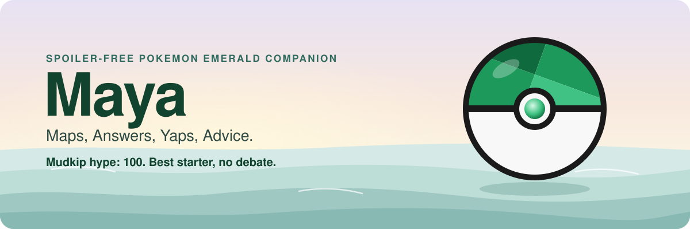
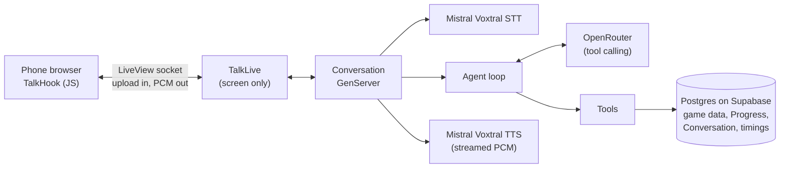

<p align="center">
  
</p>

<p align="center"><b>Maya</b> is a talking, spoiler-free Pokémon Emerald companion on a phone.</p>

<p align="center">
  <a href="ARCHITECTURE.md">Architecture</a>
  &nbsp;&middot;&nbsp;
  <a href="docs/elixir-phoenix-in-5-minutes.md">Elixir and Phoenix in 5 minutes</a>
  &nbsp;&middot;&nbsp;
  <a href="PRODUCT.md">Product</a>
  &nbsp;&middot;&nbsp;
  <a href="#decisions-and-trade-offs">Decisions</a>
</p>

<p align="center">
  <a href="https://github.com/darth-dodo/maya/actions/workflows/ci.yml"></a>
  <a href="https://codecov.io/gh/darth-dodo/maya"></a>
  <a href="https://github.com/darth-dodo/maya/commits/main"></a>
</p>

Stuck mid-route or before a gym, you hold one button, ask out loud, and within 5 seconds hear a 2 to 3 sentence answer that fits your badges and team. Maya has one promise: zero spoilers, and every fact comes from her own game data, never from the model's memory.

## How it works



The phone records one Question and sends it up the LiveView socket. A single Conversation process transcribes it, runs a hand-written agent loop whose tools read Pokémon data filtered by the Spoiler horizon, and streams the spoken Answer back as PCM on the same socket. One Phoenix app on Render (Frankfurt) and one Postgres on Supabase (Ireland), no other services. The full design is in [ARCHITECTURE.md](ARCHITECTURE.md).

**How we know it works:** 92 ExUnit tests run on every pull request with a coverage floor of 89% (89.41% measured), reported to [Codecov](https://codecov.io/gh/darth-dodo/maya). Every turn stores per-stage milliseconds (mic release, STT, TTS first byte, playback start) and `mix maya.latency` prints p50 and p95 per stage against a budget of p50 at most 5 s and p95 at most 8 s; latency numbers are pending the phone check. A 20-question spoiler probe set lands with the Sunday proof (#40). Factory gates on every PR: compile with warnings as errors, format, credo, tests with the coverage floor, sobelow, `mix deps.audit`, and a release image that must boot and answer `/health`.

## Decisions and trade-offs

| Decision | Why | Cost, or when to revisit |
|---|---|---|
| One BEAM process per Conversation, LiveView only draws ([ARCHITECTURE.md](ARCHITECTURE.md#why-elixir-and-phoenix)) | A turn is a small concurrent workflow (upload, STT, agent rounds, TTS stream, barge-in); a GenServer with monitored Tasks cancels it by killing Tasks, and a crash restarts one process, not the screen | No official AI SDKs: OpenRouter and Mistral are called with Req and the agent loop is code we own and test |
| LiveView, not an SPA ([ADR-005](docs/adr/005-voice-transport-over-liveview.md)) | The socket LiveView already holds carries the audio: no API server, no client routing, no CSP change, keys never reach the browser | Mic recording and Web Audio playback still live in one JavaScript hook with its own state machine |
| Postgres on Supabase in Ireland, app in Frankfurt ([ADR-002](docs/adr/002-postgres-on-supabase.md)) | Supabase free keeps Postgres with pgvector at $0; free Render Postgres expires | Cross-region round trip per query (estimated 20 to 25 ms, not measured), a weekly pause, no backups; revisit if DB latency hurts the 5 second budget |
| Facts only from tools and data ([ADR-004](docs/adr/004-facts-only-from-tools.md)) | Models misremember levels and places and know everything past the player's horizon; the horizon can only be enforced on data Maya controls | More "Not sure" Answers until the data covers a question; revisit by widening the data, not the model's freedom |
| Voice over the LiveView socket ([ADR-005](docs/adr/005-voice-transport-over-liveview.md)) | Upload in, streamed PCM out, so the first sound plays before TTS finishes and barge-in is a local stop plus a cancel | PCM playback code in the hook; revisit if the socket relay shows up between TTS first byte and playback start |
| Progress and the Conversation live in Postgres ([ADR-006](docs/adr/006-state-in-postgres.md)) | Render's disk is replaced on every deploy; deploys, crashes and reloads keep Progress and history, and p50 and p95 come from SQL | Every turn writes across regions, so writes happen after the Answer starts playing; revisit if history reads show up in Answer time |
| Guests in a signed cookie, isolated in app code ([ADR-008](docs/adr/008-guest-sessions.md)) | Test noise and other people never share one Conversation or Progress, with no login to build; like habla-hermano, every query filters by `guest_id` | Any visitor can spend API calls until BasicAuth (#49); a cleared cookie loses that Guest's history; isolation is app code, not row-level security |
| An agent-run software factory builds Maya ([ADR-001](docs/adr/001-agent-run-software-factory.md)) | One person, one weekend: Abhishek's time goes to product calls and gyms, and the pipeline makes the safe path the default for agents | Agents drift (skip tests, widen scope, swap the stack), so every PR passes CI gates and Abhishek merges; the factory runs only while his machine is on |
| Specs in OpenSpec next to the code ([ADR-003](docs/adr/003-openspec-for-specs.md)) | Builders in separate worktrees read behaviour rules at any commit | One more tool and folder to keep in sync; every change is archived in the PR that builds it |

## Run it locally

```bash
git clone https://github.com/darth-dodo/maya.git && cd maya
docker compose -p maya up -d --wait db   # Postgres 17 with pgvector
mix setup                                # deps, database, assets
cp .env.template .env                    # set MISTRAL_API_KEY for voice
set -a; source .env; set +a; mix phx.server   # http://localhost:4000, login maya / dev-only-password
```

Needs Elixir 1.17 or later (developed on 1.20 with OTP 29) and Docker. Without `MISTRAL_API_KEY` the app shows Answers as text. The browser mic needs HTTPS, so test voice on the phone against a deploy.

| Command | Does |
|---|---|
| `mix test` | the ExUnit suite (`mix test --cover` adds the coverage table, the floor and `cover/lcov.info`) |
| `mix precommit` | compile with warnings as errors, unlock unused deps, format, test |
| `mix maya.import` | load game data from `priv/data/` into Postgres (no network); each Guest seeds their own Progress on first use |
| `mix maya.latency` | p50 and p95 per voice stage over the stored turns |

## Built with

<p>
  
  
  
  
  
  
  
</p>

## The factory

Maya is built by an agent-run software factory ([ADR-001](docs/adr/001-agent-run-software-factory.md)): Claude Code sessions plan each block as an OpenSpec change and a GitHub Issue with a "done when", builders implement it test first in their own worktrees, CI gates every PR, Abhishek merges, and Render deploys main. Lessons from every PR feed back into the factory. How it all fits together: [FACTORY.md](FACTORY.md).

## Docs

| Doc | For |
|---|---|
| [Elixir and Phoenix in 5 minutes](docs/elixir-phoenix-in-5-minutes.md) | the language and framework, taught through this codebase |
| [Product](PRODUCT.md) | the job, the experience, spoilers, character, done when |
| [Architecture](ARCHITECTURE.md) | voice loop, processes, agent, data, deploy, build order |
| [Glossary](GLOSSARY.md) | the terms in bold across the docs |
| [ADRs](docs/adr/README.md) | settled decisions, [001](docs/adr/001-agent-run-software-factory.md) to [008](docs/adr/008-guest-sessions.md) |
| [Specs](openspec/specs/) | behaviour contracts per capability (OpenSpec) |
| [Factory](FACTORY.md) | how agents build, verify and ship Maya |
| [Factory lessons](docs/factory/LESSONS.md) · [experiments](docs/factory/experiments.md) | rules learned per station, and factory changes on trial |
| [Factory learnings](docs/factory-learnings.md) | what Maya takes from sibling repos, including the voice lessons |
| [Agent guides](AGENTS.md) · [CLAUDE.md](CLAUDE.md) | Phoenix guidelines and the handoff for agents |
| [Issue tracker](docs/agents/issue-tracker.md) · [triage labels](docs/agents/triage-labels.md) · [domain docs](docs/agents/domain.md) | how agent skills use GitHub Issues and these docs |
| [Phase 2](PHASE_2.md) | ideas parked until after the MVP |
| [Changelog](CHANGELOG.md) | what shipped, by version |

<p align="center">
  
</p>
