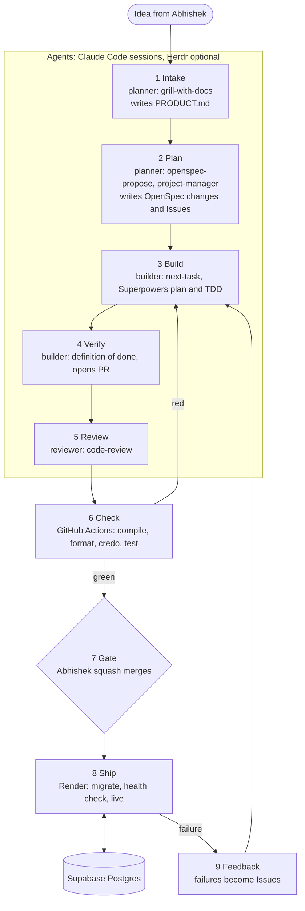

# 001: Agent-run software factory

- Status: Accepted
- Date: 2026-11-14

## Why

- One person, one weekend, a voice MVP. Abhishek's time goes to product calls and playing gyms, not typing code.
- Agents ship fast but drift: they skip tests, widen scope, swap the stack, and merge their own work. The pipeline has to make the safe path the default.

## What

Claude Code agents build Maya from PRODUCT.md to a live deploy. Humans write PRODUCT.md, answer agents, and merge. Nothing else is manual.

| Station | Owner |
|---|---|
| Intake, review | Matt Pocock skills (`grill-with-docs`, `code-review`) |
| Specs | OpenSpec (`openspec-propose`, `openspec-archive-change`), see ADR-003 |
| Build, verify | Superpowers (plan, TDD, subagents, verification) |
| Work queue | GitHub Issues, each with a "done when" |
| Check | GitHub Actions: compile with warnings as errors, format, credo, tests |
| Gate | Abhishek merges. Agents never do |
| Ship | Render deploys main after CI passes |
| Runtime | Claude Code sessions on Abhishek's Mac (`planner`, max 2 `builder-<issue>` in their own worktrees), Remote Control for the phone. Herdr panes optional for devex |

## How

Full walkthrough, including one Issue's life: `FACTORY.md`, "How it works".

### Guardrails
| Risk | Stopped by | Where |
|---|---|---|
| Agent merges its own PR | `gh pr merge` denied | `.claude/settings.json` |
| Push to main, force push | Branch protection, admins included | GitHub settings |
| Broken code ships | Required `ci-success` check (format, credo, test with coverage floor, security, docker boot), Render `autoDeployTrigger: checksPass`, scheduled post-deploy smoke check (never blocks a deploy) | GitHub, `render.yaml` |
| Stack drift | `settled-architecture` red flags, ADR for any change | Repo |
| "Works on my machine" | Definition of done with evidence | `CLAUDE.md`, PR template |
| Scope creep | New ideas go to `PHASE_2.md` | Repo |
| Overrun | 2x estimate means a cut, F1 past 3h means build by hand | `project-manager` skill |
| Overlapping skills (Matt `tdd`, `diagnosing-bugs` vs Superpowers) | `Skill(skill:...)` deny rules | `.claude/settings.json` |
| Leaked secrets | `.env` git and Docker ignored and read denied, secrets `sync: false` | Repo, Render |

Critical rules are enforced by machines that ignore prompts (GitHub, the permission deny list, Render). Skills only make the right path the easy one.

Also: Conventional Commits and a changelog entry per PR.

## Consequences

- Easier: parallel work without merge chaos, every change reviewed by CI and a human, a full audit trail in PRs and CHANGELOG.md.
- Harder: the factory runs only while the Mac is on, and agents block on any permission not pre-approved.
- Check: if F1 runs past 3h, drop the factory and build by hand (FACTORY.md).
