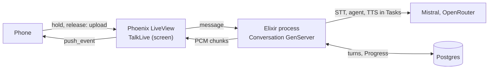

# Elixir and Phoenix in 5 minutes

The language and framework Maya is built on, explained through Maya's own code. Every snippet points at a real file on `main`. Snippets marked *planned* come from ARCHITECTURE.md and land with the voice spine (#38); snippets marked *simplified* drop logging and error handling. Why we picked this stack: ARCHITECTURE.md, "Why Elixir and Phoenix".

## The picture (30 seconds)

**Elixir** runs on the BEAM, a virtual machine built for many small processes that fail and restart on their own. **Phoenix** is the web layer on top: it turns HTTP requests and long-lived sockets into function calls. One Question touches both:



## Elixir (2 minutes)

### 1. Data never changes; functions return new data

There are no objects and no mutation. A function takes values and returns new values, so a function with no IO always gives the same answer for the same input. That is why Maya's spoiler rules can be plain unit tests (ARCHITECTURE.md, "Functional programming").

```elixir
# lib/maya_web/controllers/page_html.ex
@poke_facts [
  "Mudkip is a pure Water type, and Maya is not biased at all.",
  # ...
]

def poke_facts, do: @poke_facts
```

`@poke_facts` is a module attribute: a value fixed at compile time. `def poke_facts, do: ...` is a one-line function.

### 2. Pattern matching and tagged tuples instead of exceptions

`=` matches a shape, not just assigns. Functions return `{:ok, value}` or `{:error, reason}`, and the caller matches on the shape. A `raise` is kept for "this must never happen", like a bad secret at boot:

```elixir
# config/runtime.exs
if byte_size(secret_key_base) < 64 do
  raise "SECRET_KEY_BASE is #{byte_size(secret_key_base)} bytes, needs at least 64. ..."
end
```

```elixir
# planned: the agent turns tool results into spoken lines (ARCHITECTURE.md, section 3)
case Maya.Tools.find_pokemon("Ralts", progress) do
  {:ok, fact} -> fact
  {:error, :past_horizon} -> "Further ahead, no spoilers."
  {:error, :not_found} -> "Not sure."
end
```

### 3. The pipe: `|>`

`a |> f(b)` means `f(a, b)`. Code reads top to bottom like a recipe:

```elixir
# planned: mix maya.import (ARCHITECTURE.md, section 4), simplified
"priv/data/wild_encounters.json"
|> File.read!()
|> Jason.decode!()
|> to_rows()
|> then(&Repo.insert_all(Encounter, &1))
```

### 4. Processes and supervisors

A process is a tiny isolated thing with its own memory and a mailbox (thousands are normal). A supervisor starts processes and restarts them when they crash. The whole app is a tree of them, started here:

```elixir
# lib/maya/application.ex (abridged)
children = [
  MayaWeb.Telemetry,
  Maya.Repo,
  {DNSCluster, query: Application.get_env(:maya, :dns_cluster_query) || :ignore},
  {Phoenix.PubSub, name: Maya.PubSub},
  MayaWeb.Endpoint
]

Supervisor.start_link(children, strategy: :one_for_one, name: Maya.Supervisor)
```

`:one_for_one` means: if one child crashes, restart only that child. The voice spine adds a `Registry`, a `DynamicSupervisor` for Conversations and a `Task.Supervisor` to this list.

### 5. GenServer: a process that holds state

A GenServer is a process with a state value and callbacks for the messages it gets. Each callback returns the next state; nothing else can change it.

```elixir
# planned: lib/maya/conversation.ex (ARCHITECTURE.md, section 2), simplified
def handle_cast({:question, clip}, state) do
  task = Task.Supervisor.async_nolink(Maya.TaskSupervisor, fn -> run_turn(clip, state.turns) end)
  {:noreply, %{state | turn: task}}
end

def handle_cast(:barge_in, %{turn: task} = state) do
  Task.shutdown(task, :brutal_kill)
  {:noreply, %{state | turn: nil}}
end
```

Barge-in is just "kill the Task that is speaking". Messages are handled one at a time, so a barge-in and a TTS chunk never race inside the state.

## Phoenix (2.5 minutes)

### 1. The router and pipelines of plugs

A **plug** is a function that takes a connection and returns a connection. A **pipeline** is a named list of plugs. Routes pick a pipeline:

```elixir
# lib/maya_web/router.ex (abridged)
pipeline :browser do
  plug :accepts, ["html"]
  plug :fetch_session
  plug :protect_from_forgery
  plug :put_secure_browser_headers, %{"content-security-policy" => "default-src 'self'; ..."}
end

scope "/", MayaWeb do
  get "/health", HealthController, :show          # no pipeline: cheap, no session
  get "/health/version", HealthController, :version
end

scope "/", MayaWeb do
  pipe_through :browser
  get "/", PageController, :home
end
```

`/health` skips the browser pipeline on purpose: Render calls it often and it must not touch the session or the database.

### 2. Controllers are plain functions

```elixir
# lib/maya_web/controllers/health_controller.ex
def show(conn, _params), do: text(conn, "ok")

def version(conn, _params), do: text(conn, Application.get_env(:maya, :git_commit, "unknown"))
```

`conn` is the request and response as one immutable value; `text/2` returns a new `conn` with a body. `_params` starts with `_` because it is unused.

### 3. HEEx templates

HTML with Elixir inside. `{...}` prints a value, `:for` repeats an element:

```heex
<%!-- lib/maya_web/controllers/page_html/home.html.heex --%>
<ul id="poke-facts" class="poke-facts mt-4 rounded-2xl" aria-label="Poke facts">
  <li :for={fact <- poke_facts()} class="poke-fact">{fact}</li>
</ul>

<li :for={n <- 1..8} class="badge-slot ..." data-earned="false" aria-label={"Badge #{n} of 8"}>
  {n}
</li>
```

Templates are compiled into functions at build time, so a typo in an assign fails the build, not the page.

### 4. LiveView: the page is a process too

A LiveView renders HTML once, then keeps a WebSocket open. Its state lives in a server process; events from the browser are messages; Phoenix sends only the changed parts of the HTML back. No JSON API, no SPA.

```elixir
# planned: lib/maya_web/live/talk_live.ex (ARCHITECTURE.md, section 1), simplified
def mount(_params, _session, socket) do
  {:ok,
   socket
   |> assign(:turns, Maya.Conversation.recent_turns())
   |> allow_upload(:question, accept: :any, auto_upload: true, chunk_size: 256_000,
                   max_file_size: 1_000_000, max_entries: 1, progress: &handle_progress/3)}
end

def handle_info({:audio_chunk, pcm}, socket) do
  {:noreply, push_event(socket, "audio", %{pcm: Base.encode64(pcm)})}
end
```

The only JavaScript is a **hook**: a small object attached to one element that records the mic and plays audio, talking to this process over the same socket.

### 5. Config at boot, not at compile

`config/config.exs` is compiled in; `config/runtime.exs` runs when the release starts, so secrets and deploy facts come from the environment:

```elixir
# config/runtime.exs
config :maya, :git_commit, System.get_env("RENDER_GIT_COMMIT", "unknown")
```

Code reads it with `Application.get_env/3` (see `HealthController.version/2` above), never with `System.get_env` in `lib/` (LESSONS.md).

## How they meet (30 seconds)

```mermaid
sequenceDiagram
    participant H as TalkHook (JS)
    participant L as TalkLive (Phoenix)
    participant C as Conversation (Elixir GenServer)
    participant T as Tasks (STT, agent, TTS)
    H->>L: upload clip over the socket
    L->>C: cast {:question, clip}
    C->>T: start supervised Tasks
    T-->>C: transcript, Answer, PCM chunks
    C-->>L: send {:audio_chunk, pcm}
    L-->>H: push_event("audio", ...)
    Note over C,T: a crashing Task is restarted or reported; the screen stays up
```

## The mental model

Coming from habla-hermano (`docs/fastapi-langgraph-in-5-minutes.md`):

| FastAPI and LangGraph | Elixir and Phoenix |
|---|---|
| Route = typed function | Router line to a controller function, or a LiveView event handler |
| `Depends()` injects per-request things | Plugs add to `conn`; `assign/3` adds to the socket |
| Middleware wraps every request | A pipeline of plugs |
| LangGraph state, reducers merge updates | GenServer state, each callback returns the next state |
| Checkpointer + `thread_id` | The Conversation's turns in Postgres (ADR-006) |
| SSE or WebSocket routes | The one LiveView socket (ADR-005) |
| `try` / `except` | `{:ok, _}` / `{:error, _}` and `case`; supervisors for crashes |
| Async tasks | Processes and `Task.Supervisor` |

## Try it (pick one)

1. **Add a Poke fact.** Add a 13th sentence to `@poke_facts` in `lib/maya_web/controllers/page_html.ex`, then read the comment above it: the CSS rotation in `assets/css/app.css` is timed for 12, so update both. Run `mix test test/maya_web/controllers/page_controller_test.exs`. Keep it before the first gym and say "earn a badge", never "beat".
2. **Add a route.** Add `get "/health/time", HealthController, :time` next to `/health`, write `def time(conn, _params), do: text(conn, DateTime.utc_now() |> DateTime.to_iso8601())`, and add a test in `test/maya_web/controllers/` that asserts a 200.
3. **Look at the processes.** Run `iex -S mix`, then `Supervisor.which_children(Maya.Supervisor)` to see the tree from `application.ex`, and `:observer.start()` for a live view of every process (needs Erlang built with wx).

Next: [ARCHITECTURE.md](../ARCHITECTURE.md) for every part of Maya, [GLOSSARY.md](../GLOSSARY.md) for the words, and Elixir's own [getting started guide](https://hexdocs.pm/elixir/introduction.html) and [Phoenix overview](https://hexdocs.pm/phoenix/overview.html) for more.
